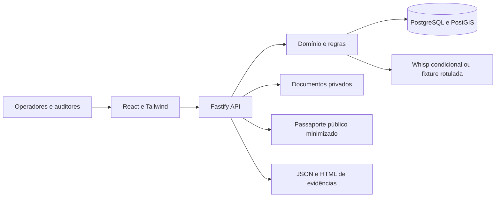

# Arquitetura do ForestTrace

Os indicadores do trace são calculados nos registros persistidos: `tracked_fraction = known_volume_m3 / total_volume_m3`, com origem desconhecida explícita em `unknown_volume_m3`; numerador e denominador são expostos como strings decimais. Para 1,8 m³ conhecidos e 1,2 m³ desconhecidos numa saída de 3 m³, a cobertura é 60%, mantendo os 40% restantes como lacuna. Em mistura 1,8/1,2 com ambas as parcelas conhecidas, as participações são 60%/40% e a cobertura conhecida é 100%. `generated_at` e `duration_ms` registram a geração do trace; a duração não representa economia de tempo medida. Contagens de checagens exibem seu denominador e não medem impacto ambiental ou redução de fraude.

O ForestTrace é um monólito modular TypeScript. Fastify publica a API e o build React; PostgreSQL/PostGIS persiste a cadeia e executa as verificações espaciais. Contratos TypeBox são compartilhados pelo workspace e alimentam o contrato HTTP.

Chamadas de IA passam exclusivamente pelo adaptador TypeScript `services/codex-cli.ts`, que executa o Codex CLI no host local. A integração preserva as regras determinísticas e produz sugestões revisáveis. O comando `npm run demo:ai` demonstra essa fronteira; configuração e limites estão em [codex-cli.md](codex-cli.md).

## Fronteiras de responsabilidade

`packages/contracts` define identificadores, rótulos de proveniência e schemas HTTP. `apps/api/src/services` contém cálculos de volume, atribuições de origem, integridade e critérios de prontidão. As rotas aplicam autenticação e escopo de acesso e persistem operações no banco. O frontend não decide status nem constitui uma fonte adicional de verdade.

Os valores de volume são strings decimais no contrato, calculados com aritmética decimal e persistidos em NUMERIC. O parâmetro de rendimento pertence a um registro versionado e vigente. Um documento de exceção deve satisfazer produto, período e escopo pertinentes; justificativa interna não aumenta volume oficialmente autorizado.

## Rastreabilidade e decisões

Cada entidade tem identificador próprio. Corte, remessa, recebimento, transformação e venda permanecem vinculados às entradas e quantidades atribuídas. O saldo não pode ser consumido duas vezes. Transformação anômala fica em revisão; qualquer fração desconhecida permanece explícita e impede prontidão.

Revisões distinguem sinal bruto, evidência contextual e decisão humana. Autor e revisor são usuários diferentes, inclusive quando pertencem à mesma organização. Resolução humana não apaga o resultado anterior, não reescreve a origem do dado e não autoriza um saldo inexistente.

Hashes SHA-256 são calculados sobre documentos e conteúdo canônico. Eventos incluem vínculo ao anterior. Essa camada detecta divergências em relação aos hashes preservados; não representa assinatura digital forte nem protege contra administrador que reescreva dados e checkpoints.

## Cobertura nacional

Cadastro e histórico aceitam as 27 UFs. A cobertura normativa é avaliada por origem, destino, produto, modalidade, percurso pertinente, sistema e data. Perfil ausente, requisito não confirmado e fontes conflitantes mantêm pendência explícita, sem impedir o registro de fatos declarados.

A matriz em `docs/research` é um inventário de fontes com limitações, não um conjunto de regras integralmente confirmado. O checklist da rota da apresentação pertence a `docs/demo-route-validation.md`; AM→SP permanece candidata até que os requisitos delimitados sejam confirmados.

## Indicadores

- Cobertura de volume: quantidade atribuída a parcelas conhecidas dividida pelo volume total do produto; mostrar também os dois valores absolutos. Origem desconhecida integra o denominador.
- Cobertura de checagens: checagens com fonte e evidência vinculadas divididas pelo total de checagens do escopo, mantendo a distinção real/simulada.
- Conflitos: contagem de checagens e casos por regra/estado, sem interpretar gravidade como probabilidade de crime.
- Tempo de geração: duração efetivamente medida para produzir o pacote.

Nenhum desses indicadores comprova redução de desmatamento, fraude ou tempo de trabalho sem experimento específico.
