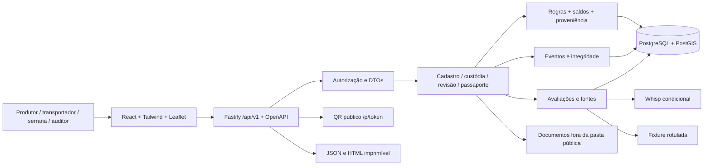

# Design

## Context

Ver `proposal.md` para motivação e `specs/*/spec.md` para comportamento. Inspeção em 05/11/2026: há README de uma linha, `License.md` vazio, skills e OpenSpec com schema `spec-driven`; não há aplicação, dependências, testes, contratos ou specs principais. A solução é greenfield neste repositório.

A stack final do pedido prevalece sobre o exemplo Python do contexto. A janela é de 48 horas, com quatro colegas de habilidades diferentes. Nenhuma chave, autorização de sistema restrito, região de demo ou licença open source foi fornecida. O plano usa fallback explícito, sem bloquear o núcleo nessas dependências.

A decisão posterior à pesquisa nacional é suportar cadastro e rastreabilidade nas 27 UFs, com pendência explícita onde faltar confirmação normativa. O inventário `docs/research/controle-florestal-27-ufs-2026-11-05.csv` é evidência de pesquisa, não catálogo de regras integralmente validado. A demo terá uma rota interestadual validada quanto aos requisitos aplicáveis no escopo declarado; AM→SP é a candidata inicial, ainda PENDENTE DE VERIFICAÇÃO. Documentos e operações sintéticos continuam simulados mesmo nessa rota.

## Goals / Non-Goals

**Goals:** transações consistentes entre saldo, proveniência e eventos; contrato compartilhado em TypeScript/OpenAPI; reprodução local A/B/C; separação pública/privada; consulta rastreável, sem confundir integridade com veracidade. As oito etapas são passos do mesmo fluxo, com entidades persistidas, não telas independentes.

**Non-Goals:** microsserviços, blockchain, envio oficial de DDS, integração restrita DOF+/fisco, assinatura forte, infraestrutura de grafos, ML treinado, autenticação de produção e retenção comprovada de cinco anos. PDF e conectores P1 entram apenas após o aceite P0.

## Decisions

### 1. Monólito modular em TypeScript

Usar workspace npm com `apps/api` (Fastify), `apps/web` (React/Vite/Tailwind), `packages/contracts` (TypeBox), Prisma e PostgreSQL/PostGIS. Fastify gera OpenAPI dos mesmos schemas que validam requests e responses. Testes de domínio/API com Vitest e banco descartável; Playwright para os caminhos públicos e a demo. Fixar versões compatíveis e lockfile na implementação.

Escolha: TypeScript em ambos os lados atende a stack solicitada e reduz duplicação. Alternativa Python/FastAPI reduziria adaptação do exemplo original, mas contrariaria a stack final. NestJS adicionaria estrutura desnecessária para o prazo. Uma API e uma SPA são suficientes; o build da SPA será servido pela API na execução empacotada.



Estrutura alvo, criada somente quando houver conteúdo:

```text
apps/api/src/{modules,services,integrations,auth,storage}
apps/api/prisma/{schema.prisma,migrations}
apps/api/tests/{domain,integration}
apps/web/src/{pages,components,lib}
packages/contracts/src/
data/{fixtures,public_samples}
scripts/{seed-demo.ts,verify-audit-chain.ts}
tests/e2e/
docs/{architecture.md,sources-and-limits.md,api-contract.md,demo-script.md}
compose.yaml, Dockerfile, .env.example, package.json, README.md
```

### 2. Geometria no banco; volumes exatos

GeoJSON é armazenado em JSONB com hash e versão. PostGIS valida `ST_IsValid`, tipo, limites, anéis e calcula hectares por `ST_Area(geometry::geography)/10000` sobre EPSG:4326. Validar fechamento antes de bibliotecas que possam repará-lo. Fixtures de área conhecida verificarão precisão. Não calcular área em graus, nem inferir licença a partir da geometria.

Alternativa: bibliotecas JS isoladas evitariam PostGIS, mas exigiriam reunir validação topológica e cálculo confiável em pouco tempo. PostGIS adiciona uma extensão local e fica provisionado pelo Compose; Prisma acessa os cálculos com SQL parametrizado, sem exigir suporte nativo a tipos espaciais. Persistir GeoJSON mantém a API portátil.

Volumes: `NUMERIC(20,6)` no banco, `decimal.js` no domínio, strings decimais no JSON. Rejeitar precisão acima de seis casas; não arredondar entradas silenciosamente. CRV e frações usam maior precisão; exibição pode arredondar, mas checagens usam valores completos. Não somar volumes de produtos incompatíveis sob um único CRV: agrupar por matéria-prima/produto/espécie/regra. Para esta demo, transformação é tora→serrado; resíduos e perdas são informados separadamente e a soma das atribuições não pode exceder a entrada.

### 3. Modelo relacional e fronteiras transacionais

Todas as entidades possuem UUID próprio; rótulos como LT-204 são códigos humanos. `plot_id`/`production_plot_id` representam o mesmo identificador de parcela; `plot_uuid` é sua descrição como UUID interno, sem GeoID FAO implícito. `geoid` é nullable e exige fonte de emissão quando preenchido.

| Grupo | Tabelas e vínculos |
|---|---|
| Identidade | organizations, users, memberships, roles, sessions; grants por organização/relação/objeto |
| Origem | plots e plot_versions; origin_lots → plots; permits → lotes/documentos |
| Evidência | documents e document_versions; data_provenance vincula entidade, campo, fonte, autor, data e confiança |
| Operação | harvests → origin_lots; shipments + shipment_items; transformations + inputs/outputs; product_lots; sales + sale_items |
| Quantidade | balances por lote/custodiante/estado; balance_movements imutáveis com referência ao evento |
| Proveniência | lot_provenance com origem, destino, quantidade atribuída, unidade e parcela ancestral; origem desconhecida explícita |
| Regra | conversion_parameters, conversion_exceptions; checks, risk_assessments; audit_cases + audit_decisions |
| Jurisdição | regulatory_requirements e versões; regulatory_assessments vinculam operação, regras aplicáveis, cobertura e lacunas; demo_route_validations delimitam a rota e o checklist aprovado |
| Tentativa | pending_operation_requests preservam payload, hash, autor, motivo e decisão sem lançar corte ou consumo confirmado |
| Trilha | custody_events; stream_heads para serialização; idempotency_keys; access_logs |
| Publicação | passports + passport_versions; evidence_bundles; document_grants e commercial_relationships |
| Consulta | sources; source_queries com request, resposta, hash, HTTP, job e opções |

Constraints: volumes positivos; vigência início ≤ fim; FKs; chaves fiscais únicas quando presentes; soma das frações/atribuições validada na transação; histórico sem UPDATE/DELETE pelo papel de aplicação. Identificadores fiscais sintéticos recebem rótulo e não são apresentados como registros consultados.

Saldo distingue autorizado, colhido disponível, reservado, em trânsito, recebido, consumido e saída em revisão. Não somar esses estados como estoque independente. Criar remessa reserva saldo; expedir move para trânsito; receber credita o destinatário pelo volume conferido e mantém divergência em reconciliação. Transformar consome apenas recebido disponível; saída anômala permanece em quarentena. Venda confirmada reserva/consome uma única vez; declaração comercial pendente não movimenta saída contestada.

Cada comando usa transação com locks de saldo em ordem estável, valida saldo e permissão, grava domínio, movimentos e evento; falha desfaz tudo. Controle de concorrência cobre duas expedições disputando saldo. Retry limitado somente para conflito serializável. R08 rejeitado fica em log/checagem de tentativa separado da transação revertida. Corte excedente R07 preserva uma solicitação pendente idempotente, com payload, hash e caso de revisão, sem criar HARVEST_RECORDED ou mover saldo. Sua aceitação administrativa pelo auditor não confirma a operação: confirmar o corte exige evidência de correção ou autorização/ajuste competente aplicável e nova validação transacional de saldo, sem duplicar consumo.

Idempotency-Key é obrigatória nas escritas operacionais. Mesma chave + mesmo payload devolve resultado original; mesma chave + outro hash retorna 409. Chaves são escopadas a ator e operação. Duplicidade fiscal gera R17 e conflito explícito.

### 4. Proveniência medida e correções

Entradas e saídas são relações N:N. Cada saída declara atribuições medidas por origem; exemplo: 1,8 + 1,2 m³ de serrado = 3 m³, frações 60%/40%. Atribuição não é inferida da ordem das entradas nem das participações de tora sem informação fornecida. Resíduos/perdas mantêm reconciliação separada. Fração desconhecida tem quantidade explícita; não normalizar apenas as conhecidas a 100%. Grafo é consulta relacional recursiva e lista de arestas no frontend, sem instalar banco de grafos.

Retificação cria versão, motivo e evento compensatório; nunca modifica o evento anterior. Se um registro já tem descendentes, a correção invalida checagens/passaportes afetados e mantém a cadeia em revisão até reconciliação. Não permitir correção que crie saldo negativo ou reescreva alocações históricas sem eventos. A demo de revisão usa evidência de exceção de CRV; não depende de um editor genérico de histórico.

### 5. Regras, escopo e revisão

Implementar R01, R07, R08, R10 e R11 primeiro; adicionar R04/R06/R09/R16/R17/R18/R19/R20 como suporte aos fluxos e ao aceite. R02 fica satisfeita conservadoramente pela exigência de polígono em todos os cadastros da demo. R03 é coberta pela exigência de atribuição. R05/R12/R13/R14/R15 avaliam apenas dados/cobertura disponíveis; nunca inventar consulta de status fiscal ou licença. Sem avaliação implementada ou evidência suficiente, registrar NAO_AVALIADO/PENDENTE, não PASSOU.

CRV vem de registro versionado com modalidade, produto, fonte e vigência; seed demonstrativo 0,35. Exceção contém documento de aprovação, órgão informado, escopo e período; no cenário sintético tudo permanece SIMULADA. O auditor não muda uma flag de aprovado: registra decisão/evidência e solicita nova execução. Checagens anteriores continuam armazenadas.

Agregação: ALERTA não resolvido implica EM_REVISAO; sem alertas efetivos abertos, qualquer requisito obrigatório pendente/não avaliado implica NAO_VERIFICADO. EVIDENCIAS_CONFERIDAS exige resultados efetivos obrigatórios PASSOU no escopo indicado, considerando resolução contextual válida sem apagar a checagem original, e revisão humana requerida concluída. A UI distingue checagem automática, resolução humana e resultado efetivo por dimensão. `human_review` é PASSOU apenas quando a revisão aplicável foi realizada; casos sem alerta podem exigir confirmação documental simples. `provenance_status=EVIDENCIA_INCOMPLETA` é campo independente do agregado e sempre bloqueia prontidão. EVIDENCIAS_CONFERIDAS em escopo demonstrativo não remove o bloqueio de simulação do pacote.

`assessment_scope` distingue `REAL` e `DEMONSTRATIVO`. Fixture não preenche uma checagem REAL ausente: a consulta real continua NAO_AVALIADO e o resultado demonstrativo vive em avaliação separada. Todo pacote DEMONSTRATIVO permanece MISSING_EVIDENCE, com selo DADOS SIMULADOS, mesmo após concluir todas as checagens da demo. O bloqueio também vale para pacote REAL que dependa de evidência simulada em qualquer ancestral ou etapa exigida: não basta mudar o rótulo do pacote. Pacote REAL só pode ficar READY_FOR_OPERATOR_REVIEW com evidências suficientes não simuladas, cobertura dos requisitos aplicáveis confirmada, todas as origens atribuídas e nenhum conflito crítico pendente. Escopo e motivos de bloqueio aparecem no JSON, HTML, passaporte e visão pública. Documentos não liberados ao perfil do exportador também são lacunas, sem vazar seu conteúdo.

Casos: ABERTO → EM_ANALISE → estado final. REJEITADO/MANTIDO_PENDENTE não liberam lote. RESOLVIDO_COM_EVIDENCIA exige o critério de resolução apropriado ao tipo de conflito. Em alerta geoespacial contextual, o auditor pode resolver com evidência e justificativa, sem um validador automático de sua interpretação: guardar a checagem ALERTA original, o indicador e a resolução separadamente; a dimensão efetiva registra revisão contextual concluída, nunca ausência de mudança. Agregação consulta resolução válida e seu escopo; documento retirado, nova geometria ou evidência contraditória exige nova revisão. Isso não resolve indisponibilidade de API nem substitui fonte ausente. Em saldo/CRV, exigir respaldo documental aplicável e reavaliação satisfatória; justificativa privada não aumenta saldo oficial. Exceções sem aprovação comprovada ou fora da vigência não alteram o CRV aplicável. Mensagens por templates explicam limite/fonte/campo; extração e LLM são P1 opcionais, sem acesso de escrita aos resultados.

#### Cobertura nacional e rota da demo

Aceitar todas as 27 UFs nos contratos de organizações, estabelecimentos e remessas; validar a sigla sem restringir o destino à rota da demo. A origem amazônica é prioridade de produto, não critério de risco. Guardar `origin_state`, `destination_state`, modalidade, produto, percurso/UFs de trânsito informados, datas, órgão emissor e `official_system` declarado por documento. Sistema e regime são selecionados por evidência e vigência, não por um mapa fixo UF→sistema.

Um requisito versionado guarda ID, jurisdição, fase (origem, transporte ou destino), produto/modalidade, condições de aplicabilidade, fonte oficial/artigo, início/fim de vigência, data de verificação, responsável, evidência exigida e critério/autoridade de resolução. A avaliação por operação guarda o conjunto esperado, sua versão, requisitos aplicáveis, justificativas de inaplicabilidade e lacunas. `regulatory_coverage` usa CONFIRMADA, PENDENTE_DE_VERIFICACAO ou CONFLITANTE, separado dos enums de resultado de checagem; lista vazia ou ausência de perfil não implica cobertura confirmada. Uma fonte histórica, notícia, URL acessível ou campo SIM no cadastro não confirma vigência nem integração executada.

Fonte contraditória, requisito aplicável não confirmado ou validade incerta gera checagem documentary_check PENDENTE e bloqueio do pacote. Permitir cadastro e histórico de fatos declarados em qualquer UF, incluindo confirmação de recebimento pelo ator: exibir natureza declaratória e ressalva normativa, sem apresentar aprovação regulatória. Preservar as invariantes de saldo/quantidade e os bloqueios específicos de volume; pendência de cobertura não impede capturar a trilha. Tolerância de recebimento permanece zero na demo como política operacional explícita; eventual parâmetro normativo exige regra e escopo próprios e não amplia autorização de corte.

AM→SP é a rota candidata porque o inventário contém procedimentos oficiais de origem/ajuste do IPAAM e de destino/migração da SEMIL. A escolha ainda não atesta validade. David e Adriano devem registrar em `docs/demo-route-validation.md`: produto/modalidade, período, municípios/percurso e trânsito relevante; órgão competente; documentos e cadastros necessários em cada fase; fontes/artigos e vigência confirmados; tolerâncias aplicáveis; checklist completo; autores e data da validação. Ausência de resposta administrativa ou checklist incompleto mantém PENDENTE_DE_VERIFICACAO. A rota só pode ser anunciada como validada quando esse escopo não tiver requisito pendente/conflitante; uma substituição de rota cumpre o mesmo gate. Validar requisitos não valida lote físico, não significa aprovação do órgão e não emite licença.

A/B/C usam essa rota normativa de referência e preservam os documentos sintéticos. Mesmo A e B após revisão comprovada continuam MISSING_EVIDENCE por simulação. Demonstrar a transição real para READY_FOR_OPERATOR_REVIEW em teste de domínio com dados de teste explicitamente isolados; nunca publicar fixture como pacote real. Confirmar todas as normas das 27 UFs fica fora da condição de entrega em 48 h: a cobertura nacional funcional com lacunas honestas e uma rota validada é o aceite.

### 6. Integrações honestas e fontes versionadas

Whisp usa adapter isolado; nenhuma URL de submit é assumida válida antes de confirmação oficial. Configuração prevê chave no servidor, timeout de 15 s por chamada, até duas novas tentativas para 429/5xx com backoff e Retry-After, sem retry automático em 401. Polling de job tem prazo total de 2 min por tentativa de avaliação; vencimento preserva job para retomada manual. Submit com resultado incerto não é reenviado cegamente, para evitar jobs duplicados. UI consulta estado local; sem fila externa no MVP.

Cache indexado por geometry_hash + opções canonizadas + versão do provedor. Registrar payload/resposta e data original; renovar por ação explícita ou mudança da chave, sem inventar garantia de atualidade. Nunca persistir cabeçalho secreto. Resultados tardios são anexados à versão de geometria original.

Sem contrato/chave/rede: `SEM_INTEGRACAO_REAL`, motivo, REAL não avaliado e fixture demonstrativa. Resultado real bem-sucedido fica armazenado para demo offline com data e selo de cache, sem alegar consulta nova. Ibama P1 usa amostra lícita com hash, data, cobertura e campos disponíveis. XML NF-e P1 é fornecido legitimamente, com parser sem entidades externas e limites de tamanho; fixture não consulta SEFAZ. DOF+/Sinaflor são referências, sem cliente de acesso restrito.

Verificação de fontes nesta proposta:

- O [guia Whisp indicado](https://whisp.openforis.org/documentation/api-guide) retornou 404 na ferramenta de consulta em 05/11/2026. Submit, opções e resposta: **PENDENTE DE VERIFICAÇÃO** antes de ativar o adapter real.
- A [compilação CONAMA hospedada pelo Ibama](https://www.gov.br/ibama/pt-br/assuntos/biodiversidade/flora-e-madeira/arquivos/dof/legislacao/20221212_Resolucao_Conama_411_6_maio_2009_compilada.pdf) foi acessível e cita alterações 474/2016 e 497/2020, além de estudo/aprovação para coeficiente superior. Isso não confirma ausência de alterações posteriores: vigência atual permanece **PENDENTE DE VERIFICAÇÃO** com David.
- A [página oficial da Comissão Europeia](https://environment.ec.europa.eu/topics/forests/deforestation/eu-deforestation-regulation-eudr_en) foi acessível e remete ao texto legal e disposições transitórias da madeira. A aplicabilidade específica por porte/produto e os pontos secundários da EUDR permanecem **PENDENTE DE VERIFICAÇÃO** no texto consolidado; a demo não depende de decidir elegibilidade jurídica.

### 7. API, payloads e erros

Rotas privadas por padrão; query pública usa serializers separados. Contratos TypeBox são a fonte de OpenAPI, com strings decimais, UUIDs, enums fechados e timestamps UTC. Exportar o documento OpenAPI para `docs/openapi.json` e validar contra respostas reais. Lista mínima:

| Método/rota | Resultado e restrição |
|---|---|
| POST /api/v1/plots; GET /api/v1/plots/{id} | Cadastro/consulta autorizada da geometria |
| POST /api/v1/origin-lots | Lote e vínculos com parcela/autorização |
| POST /api/v1/lots/{id}/assess; GET /api/v1/lots/{id}/checks | 202 se em execução; resultado persistido |
| POST /api/v1/harvests | Corte, saldo e evento |
| GET /api/v1/pending-operation-requests/{id} | Solicitação R07 pendente e revisão autorizada; não é corte confirmado |
| GET /api/v1/operations/{type}/{id}/regulatory-assessment | Requisitos selecionados, versão, fontes, cobertura e pendências no escopo do perfil |
| POST /api/v1/shipments; POST /api/v1/shipments/{id}/dispatch; POST /api/v1/shipments/{id}/receive | Confirmações separadas |
| POST /api/v1/transformations | Entradas/saídas, atribuições e checagens |
| POST /api/v1/sales | Venda ou declaração pendente explicitamente reconhecida |
| POST /api/v1/documents | Evidência com fonte, escopo e permissões |
| POST /api/v1/conversion-exceptions | Exceção documentada para posterior avaliação |
| GET /api/v1/audit-cases/{id}; POST /api/v1/audit-cases/{id}/decision | Consulta/decisão do auditor |
| GET /api/v1/lots/{id}/trace | Timeline, arestas e parcelas autorizadas |
| POST /api/v1/{entity}/{id}/corrections | Rotas concretas para lotes/remessas/transformações; nunca PATCH histórico |
| POST /api/v1/passports; GET /api/v1/passports/{id} | Snapshot autorizado |
| GET /api/v1/passports/{id}/evidence-bundle?format=json\|html | Pacote no escopo autorizado |
| GET /api/v1/passports/{id}/verify | Recalcula conteúdo, documentos e cadeia |
| GET /api/v1/public/passports/{token}; GET /p/{public_token} | DTO público e página QR |
| GET /health; GET /docs; GET /openapi.json | Saúde e contrato sem dados privados |

Exemplo de cadastro, com UUID da organização previamente criada pelo seed:

```json
{
  "organization_id": "11111111-1111-4111-8111-111111111111",
  "country": "BR", "state": "AM", "municipality": "Demo sintética",
  "declared_property": "Área fictícia", "geometry_version": 1,
  "geometry_date": "2026-02-05",
  "geometry": {"type":"Polygon","coordinates":[[[-60,-3],[-59.999,-3],[-59.999,-2.999],[-60,-2.999],[-60,-3]]]},
  "data_provenance": {"geometry":"SIMULADA","declared_property":"SIMULADA"}
}
```

O polígono é apenas exemplo numérico, sem afirmação de propriedade ou autorização; Adriano fornecerá a geometria lícita de demo. O cadastro de lote vincula `plot_id`, espécies, volume autorizado string, vigência e `permit_document_id`.

```json
{
  "code": "LT-204", "occurred_at": "2026-03-24T12:00:00Z",
  "operator_organization_id": "22222222-2222-4222-8222-222222222222",
  "conversion_parameter_id": "33333333-3333-4333-8333-333333333333",
  "inputs": [{"lot_id":"44444444-4444-4444-8444-444444444444","volume_m3":"10.000000"}],
  "outputs": [{"client_ref":"out-1","product":"SAWN_WOOD","volume_m3":"5.000000",
    "allocations":[{"origin_lot_id":"44444444-4444-4444-8444-444444444444","volume_m3":"5.000000"}]}],
  "residue_m3":"5.000000", "loss_m3":"0.000000", "assessment_scope":"DEMONSTRATIVO"
}
```

A resposta 201 da transformação registra a declaração, IDs novos e caso R10; não libera estoque contestado. R08 retorna 409 sem consumo. Em `POST /api/v1/harvests`, corte acima do saldo autorizado retorna 202 com `pending_request_id`, caso R07 e `confirmed=false`, sem `harvest_id` confirmado nem movimento de saldo; repetir Idempotency-Key devolve a mesma solicitação. Após respaldo suficiente e revalidação, nova submissão referenciando a solicitação confirma o corte uma única vez. Payload inválido continua 422. Todas as referências dos exemplos são sintéticas, não números oficiais. Decisão envia `{decision, comment, evidence_ids, conversion_exception_id?}`; somente revisão volumétrica exige nova checagem determinística, enquanto resolução contextual preserva a checagem e registra a conclusão humana separada.

Respostas autorizadas de operações, trace e bundle incluem `regulatory_coverage`, versão da avaliação e `regulatory_gaps` com fase, UF, requisito, fonte e próxima ação. O DTO público expõe somente resumo de cobertura e existência das lacunas. Prontidão e cobertura não são enums intercambiáveis, e o status de revisão de uma solicitação não confirma operação física.

Erro padrão: `{ "error": { "code": "INSUFFICIENT_BALANCE", "message": "Saldo insuficiente para expedição.", "fields": {"volume_m3":"Saldo disponível: 4.000000"}, "request_id": "..." } }`. Usar 401 não autenticado, 403 sem função/escopo, 404 objeto ausente/inacessível quando necessário para não revelar existência, 409 conflito, 422 validação e 503 dependência indisponível. Não expor stack ou segredo.

### 8. Integridade e publicação

Canonicalizar JSON conforme RFC 8785; decimais permanecem strings normalizadas. Geometria recebe normalização determinística de orientação/início de anéis e ordenação de componentes antes do hash, com versão do algoritmo. Documentos brutos usam SHA-256 dos bytes. `event_hash = SHA256(canonical({event_id,stream_id,sequence,entity,type,actor_id,timestamp,payload,previous_hash}))`, primeiro elo com previous_hash nulo.

Uma trilha por organização responsável, com eventos de recebimento referenciando o evento de expedição e seus hashes. Lock de `stream_heads` serializa append; verificador checa sequência contínua, duplicidades, ponteiros e referências cruzadas. Passaporte congela os hashes/head/contagem e IDs relevantes. Detecta mudanças relativas ao checkpoint guardado; um administrador que reescreva dados e checkpoints pode escapar à detecção. Sem ancoragem externa nem não repúdio forte.

Documentos ficam em volume privado, caminhos opacos e download autenticado. Token público aleatório tem pelo menos 128 bits de entropia; não concede acesso privado. Snapshot do passaporte é imutável; consulta agrega status atual e `requires_review` se evidência/versão ficou obsoleta. Bundle é gerado por perfil, registra duração, escopo e lacunas; campo DDS_REFERENCE não é gerado automaticamente.

### 9. Segurança e interface

Autenticação de demo: sessões locais de usuários sintéticos, habilitadas explicitamente por `DEMO_MODE=true` e restritas à execução local. Não confiar em `role` enviado pelo cliente. Seed disponibiliza seleção de personas sem dados reais; sessão HTTP-only/SameSite, validação de Origin/CSRF em escritas. Em exposição pública, desabilitar seleção aberta e configurar contas/tokens de operadores no servidor antes do deploy. Identidade continua declaradamente demonstrativa.

Comprador exige membership e grant comercial por objeto; auditor/regulador tem escopo registrado. JWT ou cabeçalho arbitrário de função não substitui autorização no servidor. Logs de acesso e negação excluem tokens e dados pessoais desnecessários. Limitar upload/tamanho de body, escapar HTML exportado e conteúdo documental, não carregar XML externo. Autorizações se aplicam também a arquivos, exportação, trace, verify e IDs adivinhados.

Separação entre autor e revisor: persistir `created_by_user_id` e autoria de cada versão/retificação a partir da sessão autenticada, preservados no histórico. O caso referencia operação, versão e seus autores. Antes de qualquer decisão, a API compara `reviewer_user_id` com o autor da operação e da versão em análise; coincidência retorna 403 `SELF_REVIEW_NOT_ALLOWED`, registra R20 e não grava decisão nem altera caso, saldo ou resultados efetivos. Autoria ausente impede decisão até identificação rastreável. Trocar papel, membership, organização ativa ou sessão mantendo o mesmo usuário não contorna a restrição; não há liberação por papel administrador. Outro usuário auditor da mesma organização pode decidir se possuir escopo e satisfizer os demais critérios de evidência. A UI informa o impedimento, mas a validação do servidor é obrigatória. Seed e roteiro usam usuários sintéticos distintos para operador e auditor; essa separação lógica não comprova identidade civil nem independência externa de auditoria.

DTO público é allowlist construída no servidor e testada recursivamente contra campos proibidos. Região pública é país/UF ou generalização aprovada, sem GeoJSON/GPS, CPF, contatos, anexos integrais ou URLs privadas. Mapa público mostra apenas geografia generalizada; mapa privado autorizado mostra parcelas reais. Oito passos visíveis, mesmo se agrupados em páginas; timeline, fontes, selos e pendências persistentes. Risco não decorre da localização amazônica.

### 10. Verificação, comandos e cobertura do aceite

Contrato de scripts a criar no apply, executável com npm em todos os sistemas:

```text
npm ci
docker compose up -d db
npm run db:migrate
npm run seed:demo
npm run dev
npm run typecheck
npm test
npm run test:integration
npm run test:e2e
npm run build
npm run verify:chain
```

Antes: Windows PowerShell `Copy-Item .env.example .env`; macOS/Linux `cp .env.example .env`. README deve informar versão Node LTS escolhida, Docker/PostgreSQL necessários, URLs reais e como executar API/SPA empacotadas. Sem credenciais significa sem chave externa: banco local é provisionado/configurado pela equipe.

| Aceite do contexto | Evidência prevista |
|---|---|
| 1–2, 14 | README, .env.example, Compose, cadastro/exemplo, inventário de fontes |
| 3, 5, 12 | Testes de persistência, UUIDs distintos, trace recursivo e timeline |
| 4, 11 | Resultado real/cache ou fallback rotulado; proveniência por campo/evidência |
| 6 | 10→3, 10→5, 10→3,5, exceção válida/inválida e saldo concorrente |
| 7 | C 60%/40%, soma das atribuições e origem desconhecida sem tolerância |
| 8 | Decisão com prova, autor/data e antes/depois; negativa sem evidência |
| 9–10 | QR navegável, allowlist pública, OpenAPI e respostas contratuais |
| 13 | Revisão de mensagens por Thamires; linguagem de evidência sem certificação |
| 15 | Documento/evento adulterado, idempotência, acesso privado negado e campos públicos ausentes |
| Cobertura nacional | Cadastro/trace nas 27 UFs; requisito não confirmado ou conflitante mantém PENDENTE e MISSING_EVIDENCE sem impedir histórico declaratório |
| Rota da demo | Checklist de requisitos de origem/transporte/destino e trânsito pertinente validado por escopo, autores/data e fontes; AM→SP ainda candidata |
| Decisões da sessão | Pacote simulado nunca pronto; contexto geoespacial resolvido com evidência/justificativa; R07 preservado sem saldo criado |

## Risks / Trade-offs

### Refinamento aprovado — calculadora de aproveitamento

Implementar serviço puro TypeScript/Decimal, contrato compartilhado TypeBox, `POST /api/v1/calculations/forest-utilization` autenticado e painel separado no passo de serraria. A calculadora é sempre DEMONSTRATIVA/SIMULADA, sem persistência operacional: não cria saldo, autorização, caso, checagem de lote ou versão de passaporte. Retorna fórmulas, entradas, unidades, parâmetros e versões, resultados por métrica, lacunas e explicações; sem score de risco ou probabilidade inventada.

Cubagem: `pi × (DAP_cm/100)^2 / 4 × altura_comercial_m × fator_forma`. O fator 0,70 é parâmetro demonstrativo, não regra universal; DAP mínimo não autoriza corte automaticamente. Registrar fonte/versão do perfil e distinguir essa aproximação da equação do PMFS aplicável.

Área efetiva é declarada explicitamente e deve satisfazer `0 <= area_efetiva_ha <= area_total_ha - area_app_ha`, com APP entre zero e área total. Não inferir área de exploração apenas descontando APP. Capacidade sob o perfil = área efetiva × intensidade; intensidade observada = tora extraída / área efetiva; aproveitamento = tora / capacidade × 100. Perfis demonstrativos: mecanizado 30 m³/ha com ciclo inicial 35 anos e sem máquinas 10 m³/ha com ciclo 10 anos. A categoria comunitária não seleciona automaticamente o segundo perfil. Fonte de referência CONAMA 406/2009, aplicabilidade/vigência ainda sujeitas à validação; art. 10 exige equação do PMFS a partir do segundo POA.

CRV observado = serrado / tora × 100; serrado esperado = tora × coeficiente; resíduos apenas como diferença declarada, sem presumir repartição de 65%. Volume adicional equivalente = `max(0, serrado/coeficiente - tora)`, apresentado como estimativa condicional, nunca prova de injeção ilegal. Perfil demonstrativo tora→serrado 0,35; 0,45 não é exceção automática (na tabela de referência corresponde a lâmina faqueada). Não aceitar aprovação de exceção enviada pelo cliente; exceções operacionais continuam no fluxo existente com documento íntegro, autoridade, escopo e vigência.

API aceita strings decimais não negativas finitas com até seis casas, IDs fechados de perfis do servidor e cubagem opcional (DAP e altura estritamente positivos). Rejeitar entradas incoerentes, precisão excessiva e perfil desconhecido com 422. Denominador zero retorna razão nula/NAO_AVALIADO e lacuna; tora zero com serrado positivo ou área efetiva zero com extração positiva são incoerências rejeitadas, nunca resultado aprovado. Resultados usam precisão decimal interna e arredondamento apenas de apresentação. Ausência de alerta matemático não atribui conformidade geral.

Aceite: casos sintéticos `120/20/100 ha efetivos, 2100→714 m³` (21 m³/ha, 70%, CRV34%) e `60/10/50 ha efetivos, 1850→1100 m³` (37 m³/ha, excesso350, CRV≈59,459459%, equivalente adicional≈1292,857143 m³), limites exatos, zero, negativos, precisão, área efetiva incoerente e impossibilidade de promover saldo/prontidão. UI mostra DADOS SIMULADOS, fonte/versão, unidades, fórmula e explicação por resultado, com exemplos carregáveis e estado de erro/serviço indisponível.

- [48 h e escopo amplo] → fatias verticais, modelos simples, corte de P1 antes de sacrificar A/B/C, mistura ou integridade; sem novos recursos H40–H48.
- [Whisp indisponível ou contrato não confirmado] → adapter desligado, fixtures explícitas, consulta real como meta condicionada e cache de execução real se obtida.
- [PostGIS/containers indisponíveis na máquina] → documentar conexão com PostgreSQL/PostGIS já instalado, sem trocar silenciosamente para SQLite.
- [Normas desatualizadas] → fontes e parâmetros versionados, referência demonstrativa e verificação específica com David antes do pitch; sem datas jurídicas fixas em regras de prontidão.
- [Confundir pesquisa das 27 UFs com cobertura normativa completa] → importar o inventário como fontes com pendências, validar uma rota no prazo e expor lacunas no restante; não promover registros a CONFIRMADA por existência de URL.
- [Rota candidata não validada a tempo] → priorizar confirmação desde H0 e encerrar checklist até H17; substituir apenas por rota que complete os mesmos critérios, ou registrar falha deste aceite sem anunciar validação inexistente.
- [Mistura física não comprovada pelo sistema] → quantidades são atribuições documentais; nível de garantia não vira rastreio físico/laboratorial sem evidência.
- [Hash sem ancoragem] → limite explícito, teste de alteração e proibição de chamar o registro de inviolável ou assinado.
- [Dado sensível no público ou cache] → DTO separado, storage privado, política por objeto e testes de vazamento.
- [Mapa depende de tiles externos] → contorno GeoJSON e histórico continuam acessíveis sem tiles; não prometer funcionamento offline integral.

## Migration Plan

1. Criar workspace, Compose e schema inicial com migrações versionadas; não há dados legados a migrar.
2. Aplicar migrações em banco novo, seed determinístico de personas/fontes/CRV/A/B/C e subir localmente.
3. Executar verificações da tabela de aceite e congelar dados/resultados usados na demo; backup do banco e documentos em diretório privado.
4. Deploy é opcional e exige sessão/segredos configurados, `.env` fora do git e verificação pública/privada. Não faz parte da criação destes artefatos.
5. Para rollback de demo, voltar à imagem anterior e restaurar backup compatível, ou recriar somente o banco descartável explicitamente identificado. Não usar rollback destrutivo sobre banco com dados reais.

## Open Questions

- Arthur: chave Whisp e confirmação de submit/opções/schema; adapter real permanece desligado até verificação, sem alterar contrato local.
- Adriano + David: municípios, percurso e fontes da candidata AM→SP para o checklist já definido; confirmação pendente não muda a arquitetura nem permite anunciar a rota como validada. Adriano fornece polígono lícito e confirma cobertura/licença da amostra Ibama se entrar no P1.
- David: elegibilidade de Arthur no evento, combinação de frentes, vigência normativa e condições EUDR específicas antes de apresentação; nenhuma dessas pendências autoriza afirmação de conformidade.
- Equipe: licença open source antes de distribuir; o arquivo vazio existente não concede licença. Hospedagem e emissão forte de credenciais seguem opcionais/roadmap.
